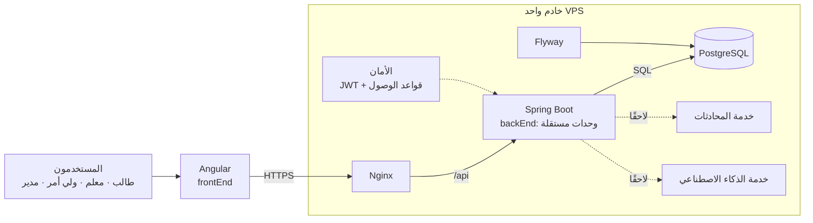

# نبراس (Nebras)

منصة لإدارة فصل المدرس الخصوصي: حضور، تقييم، اختبارات، متابعة ولي الأمر، اشتراكات، وتفاعل بين الطلاب.

*نتعلم · نلتزم · نتميز*

## الحالة الحالية
| الجزء | الحالة |
|---|---|
| `frontEnd/` | مشروع Angular أُنشئ (الإصدار 22 مع SSR). لا صفحات بعد |
| `backEnd/` | هيكل Spring Boot جاهز من Spring Initializr (إصدار 4.1.2). **لا كود للنظام بعد** |
| `docs/` | المعمارية والقرارات (ADR) ويوميات التنفيذ ودليل التشغيل |

### المراحل
| المرحلة | المحتوى | الحالة |
|---|---|---|
| 1 | الدخول، الفصول، الحضور، ولي الأمر، الإشعارات | لم تبدأ في هذا المستودع |
| 2 | التقييم، أوائل الشهر، الاختبارات، الاشتراكات، الواجبات | لم تبدأ |
| 3 | المحادثات، الفرق، سؤال الأسبوع، كتاب الشهر | لم تبدأ |
| 4 | الذكاء الاصطناعي | لم تبدأ |

## هيكل المستودع
```text
Nebras/
  backEnd/     Spring Boot (Java 21, Maven)
  frontEnd/    Angular
  docs/        المعمارية والقرارات واليوميات
  README.md
```
> ملاحظة: بعض ملفات `docs/` تذكر المجلدين باسم `backend/` و`frontend/`، والاسمان الفعليان هنا `backEnd/` و`frontEnd/`.

## المعمارية
تطبيق خلفية واحد مقسَّم لوحدات (Modular Monolith)، مع خدمتين مؤجلتين للمحادثات والذكاء الاصطناعي. الأسباب في [ADR-0001](docs/adr/0001-modular-monolith.md).



**النسخة التفاعلية** (مرسومة بأداة Archify): الملف [docs/architecture/nebras-architecture.html](docs/architecture/nebras-architecture.html). GitHub يعرض كود HTML ولا يشغّله، فافتحه [من هنا](https://htmlpreview.github.io/?https://github.com/Sherif-toiema22/Nebras/blob/main/docs/architecture/nebras-architecture.html) أو نزّله وافتحه في المتصفح.

## المتطلبات
Java 21، Maven (أو `mvnw` المرفق)، Node.js وnpm، Docker، Git.

## التشغيل
### الخلفية
```bash
cd backEnd
./mvnw spring-boot:run        # على ويندوز: mvnw.cmd spring-boot:run
```
حاليًا يشغّل هيكلًا فارغًا فقط.

### الواجهة
```bash
cd frontEnd
npm install
npm start                     # ثم افتح http://localhost:4200
```

## ابدأ من هنا
1. افهم التصميم: [docs/01-architecture.md](docs/01-architecture.md) · [الرسم التفاعلي](docs/architecture/nebras-architecture.html)
2. اعرف لماذا اخترنا ما اخترنا: [docs/adr/](docs/adr/)
3. تابع ما تم خطوة بخطوة: [docs/devlog/](docs/devlog/)
4. التشغيل والنشر: [docs/runbook.md](docs/runbook.md)

## التقنيات
Java 21 · Spring Boot · PostgreSQL · Flyway · JWT · Angular · Docker · Nginx

## قواعد العمل
- نجرّب كل خطوة قبل الانتقال لما بعدها.
- لا أسرار في Git (`.env` مستبعد).
- كل قرار تصميم مهم يُسجَّل في `docs/adr/`.
