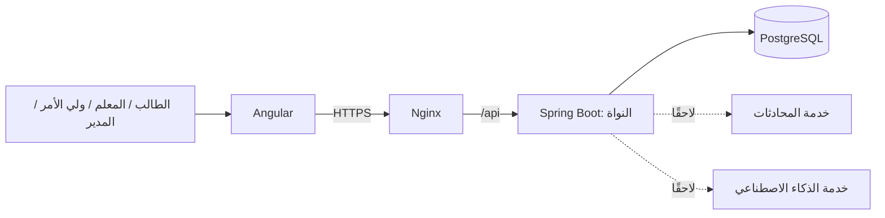

# المعمارية

## الأسلوب: Modular Monolith
تطبيق خلفية واحد مقسَّم إلى **وحدات مستقلة** (حزمة لكل ميزة)، مع الاحتفاظ بإمكانية فصل وحدتين مستقبلًا: **المحادثات** و**الذكاء الاصطناعي**. التبرير في [ADR-0001](adr/0001-modular-monolith.md).

## الطبقات داخل الخادم
`Controller ← Service ← Repository ← Entity ← قاعدة البيانات`

| الطبقة | مسؤوليتها | لا تفعل |
|---|---|---|
| Controller | استقبال الطلب والتحقق من الشكل | لا تحتوي منطق عمل |
| Service | قواعد العمل والصلاحيات والمعاملات | لا تكتب SQL |
| Repository | الوصول للبيانات | لا تعرف شيئًا عن HTTP |
| Entity | تمثيل الجدول | لا تُرجَع مباشرة للعميل |
| DTO | شكل البيانات الداخلة والخارجة | |

## الوحدات الحالية
`user`، `classroom`، `attendance`، `notification`، `admin`، `auth`، `security`.

## الأمان
- دخول بـ JWT (بدون جلسات في الخادم).
- طبقتان للحماية: **الدور** (`@PreAuthorize`) ثم **الملكية** (`Access`: المعلم لفصوله، وولي الأمر لأبنائه، والطالب لنفسه).
- كلمات السر بـ BCrypt، والأسرار من متغيرات البيئة فقط.
- التفاصيل: [ADR-0003](adr/0003-jwt-stateless-auth.md).

## البيانات
- PostgreSQL، ومخططه تحت Flyway فقط (`ddl-auto: none`). التفاصيل: [ADR-0002](adr/0002-postgresql-flyway.md).
- الجداول مصممة منذ الآن لتدعم أكثر من مدرس. التفاصيل: [ADR-0004](adr/0004-multi-teacher-ready.md).

## النشر المستهدف
خادم VPS واحد: Nginx (HTTPS وملفات الواجهة) ثم Spring Boot ثم PostgreSQL (غير مكشوف للإنترنت)، مع نسخة احتياطية يومية. التفاصيل: [runbook.md](runbook.md).

## نقاط ضعف معروفة (نعالجها في وقتها)
- لا اختبارات آلية بعد.
- لا حد لمحاولات الدخول الفاشلة (Rate limiting).
- لا Refresh token: التوكن يدوم 12 ساعة ولا يُلغى قبل انتهائه.
- شكل أخطاء الـ API غير موحّد.
